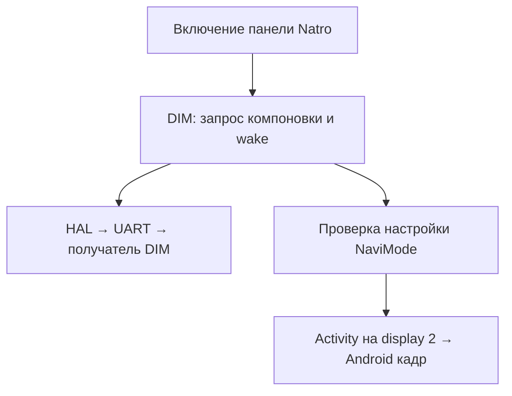

# От включения Natro до команды компоновки DIM

18.10.2026, продолжение по указанию пользователя19:46МСК: проследить цепочку от вывода навигационного приложения. STATIC по предоставленным файлам; новых команд автомобилю, runtime-патча или APK нет.

## Разделение двух путей

Natro3.3.2 source cbd0a5f97bbb9c2eadbcc3ce06fe02bf3331a088, InstrumentDisplayLauncher.prepareDim:
switchNaviMode(3) → задержка100мс → sendMessageToDIM(2,8,8,[1]) → задержка200мс → getNaviMode → допуск startPanel.
Затем InstrumentPanelTaskLauncher запускает единственный собственный intent через startActivities с launchDisplayId2. Подтверждение первого кадра отдельно от допуска запуска. Это последовательность исходников, не измерение физического времени перестроения приборки.

Рендерер на стороне C пока не установлен. Наличие карты в E не доказывает, что оформление шкал/крыльев создаётся в E. Две ветви сходятся визуально, но не следует объединять их в один Android layer только из-за общего действия пользователя.

## Повторно проверенные первичные файлы

Архив KX11-Cruise-Trace-20260809-001402.zip, SHA bbb4b7bb8c2f04864ef41777c6679e2881d2db3084563c9d10518a20cb61bc05. Файлы не объявляются идентичными текущим установленным без их свежего SHA.

| Файл | SHA256 |
|---|---|
| BOOTCLASSPATH_ecarx.adaptapi.jar |87a6fcf44f2a3a2dab7575d6e7a50396b980794074fd5fb5843162fbbde62ef0|
| BOOTCLASSPATH_ecarx.jar |126048eceb47a640ad3d96dbdcca0fa754b589799cd5876c472a713b8042dfd7|
| DIMProtocolService.apk |c435f1be2402be76355172f7d50d66d1de782a792cea912851c7571a1fd4739c|
| ECarXCarService.apk |1cab337a3c056d6ba2a7a58f12638c2b7137f672a1613a2fb78305602c6683f3|

Адреса DEX ниже — относительные байтовые смещения инструкции внутри метода.

## Что делает switchNaviMode

DimMenuInteraction.switchNaviMode задаёт msgType0, len8, opcode14; сначала пишет режим через DIMProtocolManager.setNaviMode, затем отправляет один смысловой байт:

| Режим Android | Ветка | data[0] | set / send offsets |
|---|---|---:|---|
|1 OFF|штатная|2|0xe4 /0xf8|
|2 SIMPLIFY|упрощённая|2|0xb6 /0xca|
|3 FULL|полная карта|1|0x8a /0x9c|
|4 AR|AR|1|0x5c /0x6e|

Значения3/4 различаются в локальной настройке, но показанная отправка одинакова. То же относится к1/2. Это не разрешение испытывать4 или неизвестные значения как патч крыльев. В этом сообщении нет имени приложения, bitmap или отдельного поля видимости крыльев. Ветка возвращает true даже после default неизвестного режима; boolean не является ACK физической приборки.

DIMProtocolManager.sendMessageToDIM(B,B,B,byte[]):0x6a берёт только vec[0],0x6e передаёт его через Binder как отдельный byte. DIMProtocolServiceImpl.sendMessageToDIM:0x66..0x6e создаёт ArrayList из одного byte,0xc0 передаёт в HIDL IDIMProtocol. Proxy записывает type/len/opcode/vector,0x3e выполняет transact1. Указание len8 не доказывает наличие восьми осмысленных флагов. Native-обработка длины ранее исследована отдельно; не вводить догадки о дополнительных полях.

## Readback и callback — не одно и то же

DimMenuInteraction.getNaviMode → DIMProtocolManager → DIMProtocolServiceImpl.getNaviMode:0x20 читает Settings.Global["NaviMode"] с default2. setNaviMode:0x3c делает putInt. Таким образом успешный getter подтверждает сохранённую Android-настройку, а не завершённую отрисовку или ответ получателя UART. Существующий gate Natro следует описывать как software-state readback; положительный FIELD пользователя остаётся самостоятельным свидетельством.

DimMenuInteraction$DIMProtocolServiceCallbackImpl.onReceived:opcode7 переходит на0x42e. При data0 ветка0x460 содержит сообщение «не разрешён вход в полноэкранную карту» и0x4a2 рассылает onChangeNaviMode(1). При data!=0 записывает0x07 error и выходит из этой ветви. Поэтому callback7 нельзя в этой версии SDK считать общим положительным ACK команды14. Обобщение на неполученные версии запрещено. Сам callback не доказывает ни наличие, ни отсутствие крыльев.

## Где заканчивается установленная цепочка

Ранее независимо разобранный dim_dtc.ko SHA3838e73f690c7c0c216f1a5f3e8a5757a0096d8bd954140d88fdad9ffc112796 связывает ttydim→ttyHS2; см.[driver-findings](../research-2026-10-13-dim/driver-findings-ru.txt). В этом проходе native-файлы заново не извлекались и прежний результат не объявляется новым. Драйвер переносит payload и не является установленным nav renderer. Точный peer ttyHS2 и его обработчик14 остаются незакрытой границей. QNX cluster_controller/SPI не назначать получателем без связи транспорта.

Новые wings ZIP содержат два устойчивых состояния, но не журнал вызовов14/8/callback7 между ними. Повтор двух screenshots не заполнит этот пробел. Следующий полезный материал — существующая пассивная трасса штатного перехода с общими timestamp и код самого получателя; не второй reader на ttyHS2, который может отбирать данные HAL.

## Проверка обещанного пути захвата QNX

Из уже полученного Natro-vehicle-5783067647247932076.zip извлечён openwfd_server1969280байт, SHA50f52f0714d828ead04227686ea916d488c79562f313c87146ff991e1f3e086c. Совпадает с ранее разобранным. ELF адреса ниже виртуальные, не runtime.

- wfdCreateDevice0x34080 вызывает WFD_Writeback_Open0xa73a0; wfdDeviceCommit0x34c28 вызывает WFD_Writeback_Commit0xa7908. Поэтому найденная ветвь не просто чтение существующего финального кадра.
- Open: ValidateOpenParams0xa73d0; FrameBufferMap_Open0xa7514/0xa76c0; RegisterFrameBuffer0xa7588/0xa7734; RateControl_Open0xa761c/0xa780c. На ошибке0xa78e8 вызывает Close. Это подготовка/регистрация буферов и состояния.
- Commit перебирает изменённые записи: RemoveRequest0xa7b64; AddSuspendRequest0xa7d44 либо AddRequest0xa7db8. Привязка этой ветви именно к финальному QDI1 и сохранение вывода на физической приборке не доказаны.
- WFD_UtilityMgr_Close0xa1980 удаляет critical section, три event и thread через DestroyThread0xa1b78. В просмотренном Close нет вызова SetEvent для unlock. Это не доказательство зависания: эффекты DestroyThread/внешнего caller ещё не разобраны. Но наличие Close само по себе не подтверждает безопасный timeout/cleanup общей блокировки.

Автоматическая кнопка «конечный снимок DIM» пока не обоснована. Исследование writeback продолжать статически; его наличие не заменяет проверенную область пикселей. Обычный Screen capture и композиционные метаданные также не объявлять конечным кадром QDI1.

## Результат

Предложение проследить цепочку от включения приложения применено: отдельно установлены запрос компоновки, wake, локальный readback, запуск окна и отрицательный callback. Получатель команды14/выбор геометрии крыльев пока не найден. CLUSTER_WINGS OPEN. SOURCE runtime без изменений; TEST здесь — статический разбор/сопоставление, APK/FIELD новых действий отсутствуют.

## 18.10.2026 после20:03МСК — второй потребитель callback7 и публикация режима

Продолжение по USER «Ищи дальше». Важное ограничение предыдущего вывода: отрицательная обработка callback7 описывала только DimMenuInteraction, не весь SDK. В том же adaptapi JAR NaviInteraction$DIMProtocolServiceCallbackImpl обрабатывает opcode7 иначе. Таблица packed-switch проверена отдельно: keys[1,2], targets[35,4] относительно инструкции0x0c (code units), то есть data1→0x52, data2→0x14.

- data1: getter локального режима0x6a; при mode3 вызов onDoInteractionAction(35,null) в0x92; при mode4 action36 в0xba. Строки обозначают разрешение полной/AR карты.
- data2: onDoInteractionAction(33,null) в0x3a — требование выхода. data0 не входит в эти две ветви, но отдельно обработано меню как отказ.
- Конструктор NaviInteraction регистрирует свой DIM callback в0x2e; registerNavigationInteractionCallback сохраняет callback приложения в0x36. Поэтому разрешение может дойти до приложения, хотя меню на ненулевой data пишет error. Утверждение «callback7 только отрицательный» для всего SDK неверно и здесь исправлено. Ни action35, ни transport ACK не подтверждают физический кадр/крылья.

Публикация режима приложением: updateExtensionInfo читает EXT_KEY_DIM_DISPLAY_MODE, вызывает manager.onChangeNaviMode(1/2/3/4), затем во всех четырёх ветвях sendMessageToDIM(2,8,8,[1]). Сервис onChangeNaviMode рассылает RemoteCallbackList (invoke0x4e), а не пишет Settings.Global и не отправляет opcode14 в этом методе. DimMenuInteraction.NaviFunctionCallback передаёт событие в DimRepository. Repository ставит currentNavMode/IS_FULL_SCREEN_MODE, очищает cache и передаёт на главный поток. MainViewModel публикует LiveData0x10 и вызывает FullMapFragment0x2e; тот меняет видимость popup/navigation-контейнера. MainActivity observer7 устанавливает fullscreen LiveData и видимость viewMenuContain. Этот прослеженный путь не устанавливает владельца физических крыльев и не является независимым hide.

Историческая сверка: updateExtensionInfo и положительный RX7/data1 уже были в исследовании12.10, а ttyHS2→0x890000/QUP4 подтверждён sysfs14.10. Это не новые открытия; предыдущий узкий отчёт следует читать с этими дополнениями. В текущем проходе повторно найден boot log из Cruise Trace: logcat-static-full.txt,24699820байт,SHA3db01217988d24cab7fc04277806e777bc2d625b3b1c868174bdee6f0fd0d939, строки393/998/1000 связывают ttyHS2 с MMIO0x890000 и max9675x_uart_open. Он не раскрывает внешний endpoint. См. [UART12.10](../research-2026-10-12-13-archive/dim-oct12/Natro-DIM-UART-parameters.txt) и [sysfs/panel14.10](../research-2026-10-14-dim/README_RU.md).

Следующий незакрытый участок — код внешнего получателя/его идентификатор и выбор геометрии после разрешения; не повторное установление номера UART. Вызов callback вручную не проверялся и не предлагается как исправление. Runtime/APK без изменений, CLUSTER_WINGS OPEN.

## 18.10.2026 после20:08МСК — проверка прикладных FULL/AR consumers

USER: продолжить после уточнения четырёх режимов SDK. Дополнительно просканированы все classes*.dex трёх APK из того же Cruise Trace: XSFOpenAPIService (2DEX,SHA eab4552733023ca7a323df2b9ae35b036107e3895ad5fd01b7b27540f47ed158), EcarxMultidisplayService (1DEX,SHA73e6dd017c06e1999741f32e77008f09664595856f718ecd0e22c20e8a95a06f), AdaptApiTestApp (1DEX,SHA517de12dc167fc3570579eec8203cfc0c85fc95448b3b0f8355770ef7ba9211e). Поиск прямых references onDoInteractionAction/registerNavigationInteractionCallback/EXT_KEY_DIM_DISPLAY_MODE/NAVI_MODE_AR/ACTION_DIM_DISPLAY/getNaviMode/NaviMode:0совпавших методов во всех трёх. Это ограниченный отрицательный результат, не исключение native/reflection/загружаемого кода. Прикладной AR renderer не найден.

Повторно проверен штатный DimMenu: NavigationFragment.navTitleList создаёт только два пункта (домой и fullscreen), NavigationViewModel.handlePressBehavior branch1 вызывает switchFullMode, тот переключает1/3, не4. Значит четыре SDK-константы не доказывают четыре доступных режима этой версии меню. FullMapFragment показывает свой контейнер только при3; скрытие его при4 не означает скрытие физических крыльев. Это сверка уже описанных механизмов, не новый обход.

Исторический контроль важен: [handler-check13.10](../research-2026-10-12-13-archive/dim-oct13/DIM-handler-check-2026-10-13.txt) уже не нашёл прямого callback handler в проверенном Навигаторе30.3.0/Natro3.1.3. В исходниках текущей Natro3.3.2 прямой регистрации такого callback также не найдено; собственный prepareDim/startPanel не требует action35/36. Поэтому последовательность разрешение→callback→публикация описывает возможный SDK-контракт, не доказанный сквозной runtime-путь нашей панели.

[Полная цепочка13.10](../research-2026-10-12-13-archive/dim-oct13/DIM-complete-chains-2026-10-13.txt) дополнительно фиксирует два ограничения, обязательных для текущих выводов: (1) Settings.System.fullMap через зарегистрированный SettingsObserver также создаёт callback7, поэтому callback без HAL trace не удостоверяет физический RX; (2) наблюдатель display_on_dashboard только читает/логирует, прямых вызовов syncNavigationMode там не найдено. Не выдавать этот метод за активное управление компоновкой. Значения EXT_KEY_DIM_DISPLAY_MODE —33/34/35/36, не1/2/3/4: это отдельное пространство action IDs.

Итог: ветвь AR не дала подтверждённого способа убрать крылья при сохранении карты. Для дальнейшего продвижения приоритет остаётся у кода внешнего получателя и его идентификатора, а не перебора режимов SDK. Новых runtime-изменений, APK и FIELD нет; CLUSTER_WINGS OPEN.
