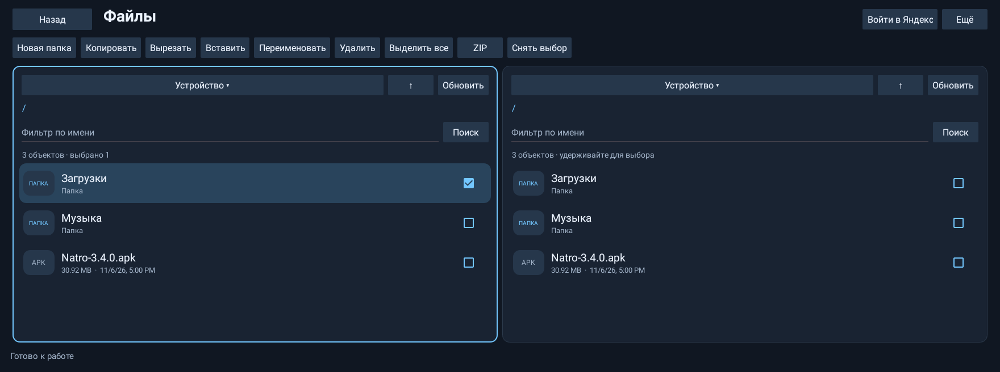

# Natro3.4.0 — файловый менеджер с Яндекс Диском

**06.11.2026: Natro3.4.0 опубликована в stable/latest.** Release436867441, publisher42274377501/job128086794811 SUCCESS; все7assets скачаны и побайтно сверены. Публичный APK и natro-update.json проверены отдельно:29952608bytes, SHA256 b11462f99824478df39b486b46f4932dd300492cbb04f112b0bd05dcd8a6afce. Source f974c09df69350a48fa7ada2889bb7d727146d5c; build CI42271336453 PASS2258Android/280tool. FIELD остаётся OPEN. Прежние записи об отсутствии публикации ниже — история.

APK готов к установке поверх3.3.9: versionCode208021373, 29952608bytes.
[Возможности и инструкция](release-notes.md), [протокол Яндекса и ограничения](../../FILE_MANAGER_YANDEX_RU.md).

SOURCE `f974c09df69350a48fa7ada2889bb7d727146d5c`, tree `7619314ef00579b9a53fd615ec88502c49d9a365` опубликованы в
`feature/file-manager-yandex-20261106`. [CI42271336453](https://github.com/AGKulikov/Status/actions/runs/42271336453)
SUCCESS:2258Android tests и280tool tests,0failures/errors/skips. XML пересчитан
из скачанного CI-кандидата; SHA архивов совпал с GitHub digests. Инвентари:
98storage owners,48editors/253forms/3017labels PASS.

APK SHA256 `b11462f99824478df39b486b46f4932dd300492cbb04f112b0bd05dcd8a6afce`.
Один прежний signer,v2/v3/exactAPI28,zipalign16KiB,package/label/min/targetSDK28,
versionCode=3.3.9+1 PASS. Все1517payload entries совпадают с проверенным unsigned
CI APK после подписи. DEX новых классов и nonexported Activity/service проверены.
[Машинный отчёт](release-report.json), [подпись](signature-verification.txt),
[CI evidence](ci-verification.json). APK передаётся отдельно; stable/latest
этой задачей не изменяется. Фактическая установка поверх на машине ещё OPEN.

Navigator patch совпал с3.3.9:1aa6f536cf9464a1b0d32da5abfc47d7a528e5b9d509417dad41acb619956490.
Новая пара для файлового менеджера не нужна; прежняя совместимость Алисы
относится к Navigator из3.3.9. Helper не менялся.

| Требование | SOURCE / TEST / APK | FIELD |
|---|---|---|
| FILES-001: встроенные локальные операции и USB | PASS:15filesystem/ZIP+3UI теста, новые компоненты в APK | USB и KX11 OPEN |
| FILES-002: вход и личный/публичный Диск как в примере | PASS:2Passport+9Disk fixtures, код в APK | Реальный аккаунт/login/transfer OPEN |
| FILES-003: безопасная передача/ZIP/секреты/backup | PASS: fault/ZIP/defaults335…372→373, review98owners | Обрыв/low-space/restore OPEN |
| REL-001…011/017 | SOURCE/CI/provenance/signature/version/pair PASS | install-over OPEN |

Native Android28 render1760×656 просмотрен после safe-inset/back изменений;
compact720dp проверен. Ни один снимок не выдаётся за экран реальной магнитолы.

История проверки: первый CI42270390165 —2255tests/3failures по общим контрактам
UI. Внесены общий звук long press, безопасный Back/inset и coverage новых экранов;
старые assertions сохранены. Итоговый CI выше PASS. Live private web API
Яндекса не проверялся учётной записью пользователя и может измениться на сервере.
