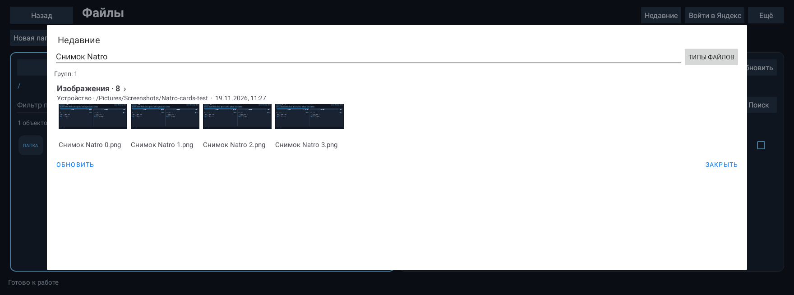

# Natro 3.5.1 и Навигатор 30.3.0 Natro 3.5.1

Кандидат от 19 ноября 2026 года, ветка `release/natro-3.5.1`. Код Natro — `208021384`, Навигатора — `739564632`. Для «Недавних» меняется Natro. Для показа полной таблички у поворота на приборке и HUD обновляются оба приложения. Последняя подтверждённая публикация до этого кандидата — Natro 3.5.0 и Навигатор 3.4.9. [Публикация Natro 3.5.0](../3.5.0/publication-verification.json) · [Манифест Навигатора 3.4.9](../3.4.9/navigator-update.json).

Код приложений впервые опубликован коммитом `afa773496d2fab30babbf55f2f5fe6e3e9bdc751`, дерево `d76ac38f961d0041b2e600e2fee495690e1b628e`. При подготовке повторной сборки исправлено повторное упоминание идентификатора в реестре требований. [Исходный коммит](https://github.com/AGKulikov/Status/commit/afa773496d2fab30babbf55f2f5fe6e3e9bdc751) · [GitHub Actions 44496972663](https://github.com/AGKulikov/Status/actions/runs/44496972663).

## Что изменилось

- **Навигация.** На фотографиях владельца основной экран показывает у перекрёстка полосы, 500 м и «Нагатинский бул.», а приборка — только полосы. В кандидате независимые карты получают оригинал видимой таблички и привязывают его к подтверждённой позиции на текущем маршруте. Объединённая табличка заменяет знак полос только у этого манёвра. Для подтверждения требуется активная и видимая основная карта с табличкой целиком в кадре. Когда её поверхность недоступна, снова действует обычная отрисовка полос. [Разбор по исходному APK и условия проверки](../../NAVIGATOR_TURN_BALLOON_2026_11_19_RU.md).
- **Файлы.** «Недавние» отбирают по типу и дате изменения за 31 день. Группа файлов одного типа из одной папки на одном томе показывает общий счётчик и до четырёх элементов. Нажатие на заголовок открывает всю группу. TXT и «Другие документы» можно включить в настройках типов. [Правила и примеры](../../FILE_MANAGER_RECENTS_ES_RU.md).

Снимок тестового окна размером 1760 × 656 показывает четыре миниатюры для группы из восьми файлов.

## Что проверено

| Уровень | Результат |
|---|---|
| Исходный Навигатор | Для подписанного APK 3.4.9 сверены 17 сигнатур методов, восемь ссылок в методах моста и два признака в ARM64-коде. Подтверждены отдельная штатная текстура, её точка привязки и собственная видимость метки. |
| Код Навигатора | Четыре локальных тестовых набора скомпилировали и выполнили код наблюдения, сравнения изображения, обработки штатной фабрики и отрисовки метки. Использованы тестовые карты и поверхности. |
| Код Natro | В локальном Gradle прошли 87 из 87 целевых Android-тестов. Из них 8 проверяют отбор и группы, 5 — экран файлов, 43 — миграции, 1 — реальное восстановление тестового архива в Robolectric, 30 — контракт навигационного HUD. Проверка исходного инвентаря хранения охватила 99 владельцев. |
| APK и канал обновлений | Подпись, сверка APK с результатом полного CI и повторная загрузка из канала ожидаются. |
| Автомобиль | На прежних версиях есть фото расхождения. Для новой пары открыта проверка на трёх экранах при приближении к повороту, проезде и перестроении маршрута. Предстоит отдельно проверить доступность основной карты при переключении приложения на магнитоле и возврат подсказки после открытия Навигатора. Для файлов открыта проверка внутренней памяти и подключённого USB на ECARX KX11. |

[Описание обновления Natro](release-notes.md) · [Описание обновления Навигатора](navigator-release-notes.md).
